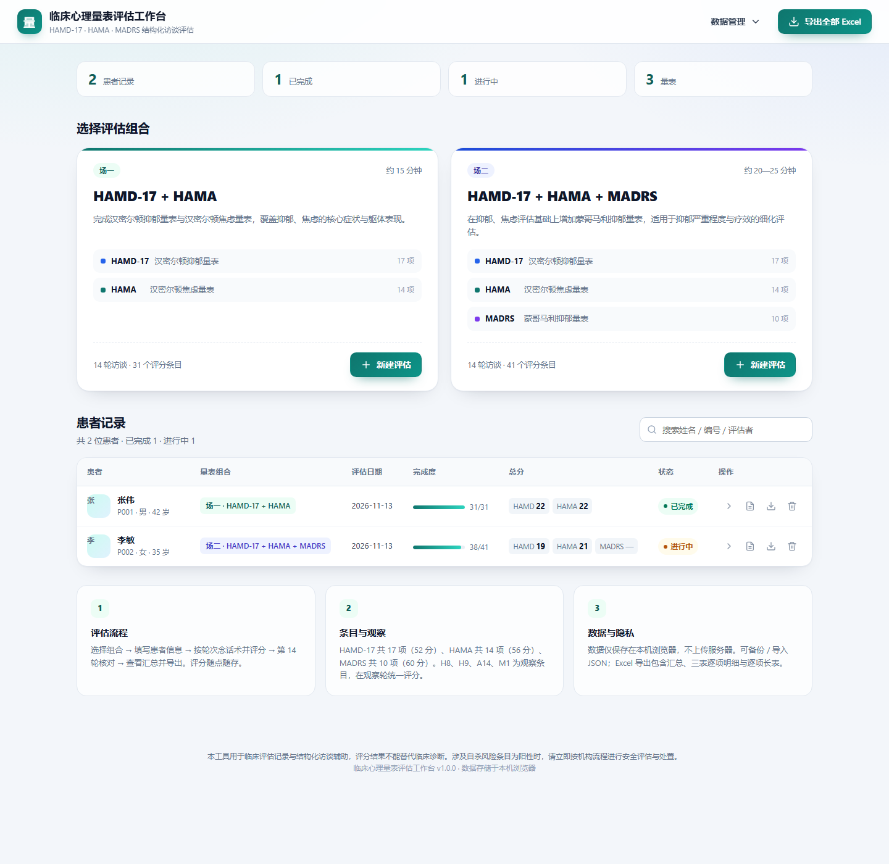
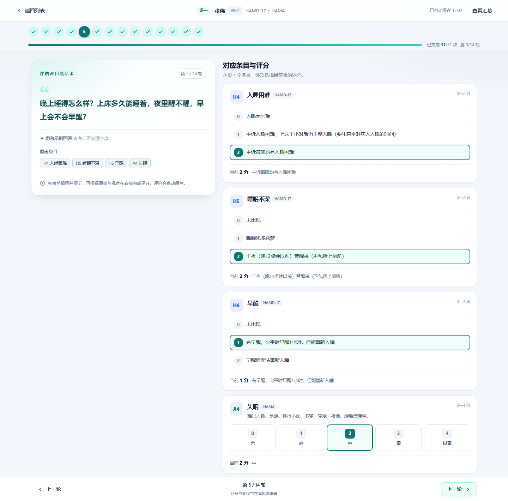
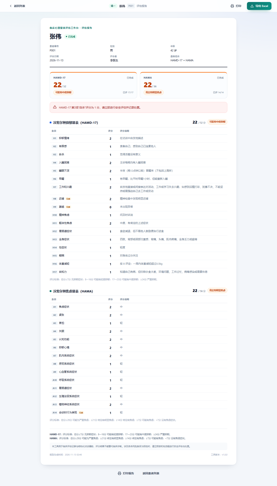

# 临床心理量表评估工作台

面向医生（评估者）的本地网页：按《话术》逐轮自然提问，**左侧显示评估者话术，右侧同步完成条目评分**，覆盖 HAMD-17、HAMA、MADRS 三个量表，并导出每位患者的逐项评分。

- 两套题目选项：**HAMD-17 + HAMA**（场一）与 **HAMD-17 + HAMA + MADRS**（场二）
- 每套 14 轮访谈，题目与条目对应关系来自《话术.docx》，评分标准来自《3合1.pdf》
- 患者记录、评分、进度自动保存在本机浏览器；可导出 Excel / CSV / JSON 备份
- 电脑、手机、平板均可使用；页面已适配移动端，可在同一 Wi-Fi 下访问
- 无需安装、无需联网（局域网访问时仅需电脑与手机在同一网络）



## 快速开始

1. 将**整个文件夹**复制到本地电脑（不要只复制 `index.html`，`assets` 目录必须一起保留）。
2. 双击 `打开网页.bat` 或 `index.html`，推荐使用 Chrome / Edge（也支持 Firefox）。
3. 在主页选择评估组合 → 填写患者信息 → 开始评估。
4. 按左侧话术逐轮提问，在右侧点选评分；第 14 轮核对后点击“完成评估并查看报告”。
5. 在报告页打印，或在主页/报告页导出 Excel。

> 如果双击后页面样式或脚本缺失，请确认 `index.html` 与 `assets/` 文件夹在同一目录。

## 手机 / 平板访问

页面已做移动端适配：手机上左右分栏会变为上下排列，轮次条可横向滑动，患者记录变为卡片，评分按钮、报告和打印均可正常使用（已在 390px 宽度实测）。

### 方式一：同一 Wi-Fi 局域网访问（推荐）

1. 电脑与手机连接同一个 Wi-Fi / 局域网。
2. 双击 `手机访问-启动服务.bat`，窗口会列出电脑的 IPv4 地址并启动服务（端口 8000）。
3. 在手机浏览器（Chrome / Safari / Edge）打开：`http://电脑IP:8000/`，例如 `http://192.168.1.23:8000/`。
4. 如果手机打不开：检查电脑 Windows 防火墙是否允许 Python 通过；或编辑 bat 文件，把 `8000` 改为其他端口后重试。
5. 使用结束后，在电脑命令行窗口按 `Ctrl+C` 停止服务。

> 手机端数据同样只保存在手机浏览器中；电脑与手机的数据**不互通**。需要转移时，用“备份数据（JSON）”或导出 Excel，再在另一台设备导入。

### 方式二：部署到内网 / 静态服务器

把 `psy-scale-web` 整个文件夹放到医院内网静态服务器或任意 HTTPS 静态托管，手机访问对应网址即可。页面无后端、无数据库，不会向服务器上传患者数据。

### 方式三：直接拷贝到手机

Android 可用 Chrome 打开本地 `index.html`；iOS 对本地文件中的脚本 / 本地存储限制较多，不建议。为保证功能完整，优先使用方式一或二。

### 手机使用提示

- 下载文件：Android Chrome 在“下载”中；iPhone 在“文件”App 的下载项中，可用 Excel / WPS 打开。
- 打印报告：iPhone 用 AirPrint，Android 用 Chrome 打印；也可先导出 Excel 再处理。
- 不建议在微信内置浏览器中打开（下载与打印支持较差），请使用系统浏览器。
- 手机端建议横屏或使用平板进行评分，按钮更大、查看条目更方便。

## 页面结构

| 区域 | 内容 |
| --- | --- |
| 主页 | 两套评估组合入口、患者记录列表、搜索、数据导出与备份 |
| 评估页左栏 | 评估者自然话术、患者示例回答（参考，不必逐字念）、本页覆盖条目、观察提示 |
| 评估页右栏 | 对应量表条目、完整评分标准、点选评分、当前评分提示 |
| 顶部/底部 | 14 轮步进器、完成进度、上一轮 / 下一轮、返回列表、查看汇总 |
| 第 14 轮 | 三表核对：各量表总分、未评条目（可点击跳转补评）、完成评估 |
| 报告页 | 三个量表总分与严重程度、逐项评分表、安全提示、打印 / 导出 |



## 两套题目选项

| 组合 | 对应场次 | 量表 | 条目数 | 访谈轮次 | 预计用时 |
| --- | --- | --- | --- | --- | --- |
| HAMD-17 + HAMA | 场一 | 汉密尔顿抑郁量表 + 汉密尔顿焦虑量表 | 31 | 14 | 约 15 分钟 |
| HAMD-17 + HAMA + MADRS | 场二 | 上述两表 + 蒙哥马利抑郁量表 | 41 | 14 | 约 20—25 分钟 |

- 场二可独立完成三表；若已做场一，实际试验中不要同日为填表重复评估，应按方案访视窗口；作为模拟训练可独立使用。
- **观察条目**：HAMD 的 H8（迟缓）、H9（激越），HAMA 的 A14（会谈时行为表现），MADRS 的 M1（观察到的抑郁）。这些条目在观察轮统一评分，M1 同时可在第 1 轮初步评分、第 13 轮复核。

## 评分与分级

### HAMD-17（0—52 分）

- 17 个条目：H1—H17。其中 9 个条目按 0—4 分计分，8 个条目按 0—2 分计分。
- H14 性症状可选择“不能肯定，或该项对被评者不适合（不计入总分）”，该条不计入总分与满分。
- H16 体重减轻须选择 A（按病史）或 B（按体重记录）之一后评分。
- 分级：≤7 分 无抑郁症状；8—16 分 可能有轻度抑郁；17—23 分 可能有中度抑郁；≥24 分 严重抑郁。

### HAMA（0—56 分）

- 14 个条目：A1—A14，每条按 0—4 分（无 / 轻 / 中 / 重 / 极重）。
- 分级：≥29 分 可能为严重焦虑；≥21 分 肯定有明显焦虑；≥14 分 肯定有焦虑；≥7 分 可能有焦虑；<7 分 没有焦虑症状。

### MADRS（0—60 分）

- 10 个条目：M1—M10，每条 0—6 分；0/2/4/6 有明确描述，1/3/5 表示介于相邻等级之间。
- 分级：≥35 极度抑郁；30—34 重度抑郁；22—29 中度抑郁；12—21 轻度抑郁；<12 缓解期。

> 涉及自杀风险条目（HAMD 的 H3、MADRS 的 M10）为阳性时，页面会显示安全提示，请立即按机构流程进行安全评估与处置。

## 导出说明

- **Excel（.xlsx）**：每位患者单独导出，或主页“导出全部 Excel”。包含 5 个工作表：
  1. `汇总`：患者信息、量表组合、完成度、三表总分与严重程度、安全提示；
  2. `HAMD-17 明细`：一行一位患者，H1—H17 逐项评分与总分；
  3. `HAMA 明细`：A1—A14 逐项评分与总分；
  4. `MADRS 明细`：M1—M10 逐项评分与总分；
  5. `逐项明细-长表`：一行一个“患者 × 条目”，便于统计分析。
- **CSV（长表）**：UTF-8 带 BOM，可直接用 Excel / WPS 打开。
- **JSON 备份**：用于换电脑、换浏览器或清空后恢复；“导入备份”会覆盖当前记录。
- 未完成的量表在汇总表中总分留空，但已评条目仍会导出；报告页可查看未评条目并继续评估。

## 数据与隐私

- 数据保存在当前浏览器的 `localStorage` 中（键名 `psy-scale-workbench-v1`），**不上传任何服务器**。
- 换电脑、换浏览器、清理浏览器数据后记录不会同步，请用 JSON 备份迁移；共用电脑请在评估结束后导出并“清空全部数据”。
- 本工具用于临床评估记录与结构化访谈辅助，评分结果不能替代临床诊断。

## 文件结构

```
psy-scale-web/
├─ index.html          # 页面入口
├─ 打开网页.bat        # 双击用默认浏览器打开
├─ 手机访问-启动服务.bat # 同一 Wi-Fi 下供手机访问（需 Python）
├─ assets/
│  ├─ data.js          # 量表条目、评分标准、两套 14 轮话术
│  ├─ core.js          # 计分、严重程度、完成度、安全提示
│  ├─ xlsx.js          # 纯前端 XLSX 生成（无第三方依赖）
│  ├─ export.js        # Excel / CSV 数据组织
│  ├─ app.js           # 页面渲染与交互
│  └─ styles.css       # 样式与打印样式
└─ docs/               # 预览截图
```

## 修改与定制

- 量表条目、评分选项、话术与轮次映射都在 `assets/data.js`：条目编码（如 `H1`）需全局唯一，选项值 `v` 需与分值一致。
- 分级阈值在 `assets/core.js` 的 `severityOf()` 中。
- 如需增加“评估者签名”“诊断”等字段，可在 `core.js` 的 `createPatient()` 与 `app.js` 的新建表单/报告页中同步增加。
- 所有文件均为静态资源，可放到任意 HTTPS 静态服务器或医院内网服务器；也可直接本地打开。

## 浏览器兼容

- 电脑推荐 Chrome / Edge 90+、Firefox 100+；手机推荐 Android Chrome、iOS Safari。
- 直接双击 `index.html`（`file://` 协议）即可使用；本地存储不可用时会提示“数据仅保留在当前页面”，此时请改用 `手机访问-启动服务.bat` 或静态服务器访问，或及时导出。
- Excel 导出为标准 `.xlsx`，可用 Microsoft Excel、WPS、LibreOffice 打开。
- 手机访问时请使用系统浏览器（Chrome / Safari / Edge），不建议使用微信内置浏览器。


